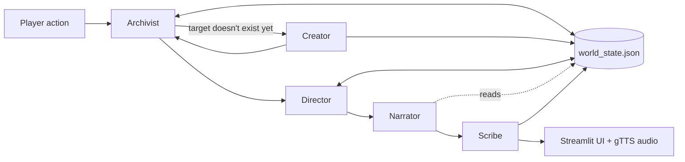

# AI Dungeon

A text adventure where a small group of Gemini agents run the game between them. You describe the kind of story you want, it builds a starting world, and from then on you type what you do and the agents work out what happens, keep the world consistent and narrate the result. It runs as a Streamlit app with a map, character sheet, journal and read-aloud narration.

## Why I built it

I wanted to see if splitting a game master into separate agents, each with one job and a shared world state, would stop the usual problem of an LLM forgetting things or letting you do anything you like. It mostly does. The Archivist will refuse impossible actions and NPCs remember if you robbed them.

## How it works

Each turn goes through the agents in order. They all read from and write to one JSON world state (player, locations, NPCs, story state, journal).



- **Archivist** (`archivist.py`) is the rules. It checks whether the action is possible and returns updates for NPCs, locations, items and the player.
- **Creator** (`creator.py`) builds the opening scenario, and makes new locations, NPCs or items when you go somewhere that doesn't exist yet.
- **Director** (`director.py`) handles pacing. It updates the current objective and tension and tells the Narrator what to focus on.
- **Narrator** (`narrator.py`) writes the 3-4 sentences you actually read, and has to include the Archivist's outcome.
- **Scribe** (`scribe.py`) reads the narration back and adds anything new it mentions (items, NPCs, places, lore) to the world state, so the story and the data don't drift apart.
- `utils.py` loads and saves the world state.

## Running it

You need Python 3.10+ and a Gemini API key. Graphviz has to be installed on the system for the map.

```
python -m venv .venv
source .venv/bin/activate        # .venv\Scripts\activate on Windows
pip install -r requirements.txt
cp .env.example .env             # then put your key in .env
streamlit run app.py
```

Or with Docker:

```
docker build -t ai-dungeon .
docker run -p 8080:8080 --env-file .env ai-dungeon
```

Then open http://localhost:8080.

## Tests

```
pip install -r requirements-dev.txt
pytest
```

The tests cover saving and loading state, how the Archivist's updates get applied, and one full turn. The Gemini calls are faked so they run offline without a key.

## Known limitations and next steps

- There's a single `world_state.json` shared by everyone, so two people playing at once on the same server will overwrite each other's game. Fine for running locally, but it would need per-session state before hosting it properly.
- Each turn makes four or five model calls, so it's a bit slow and uses quota quickly.
- The agents trust the model to return the right JSON shape. If it doesn't, they fall back to safe defaults rather than crashing, but the turn can feel flat.
- It uses the `google-generativeai` package, which Google has deprecated in favour of `google-genai`. Moving over is on the list.
- I'd like to add saved games and an image for each scene.
